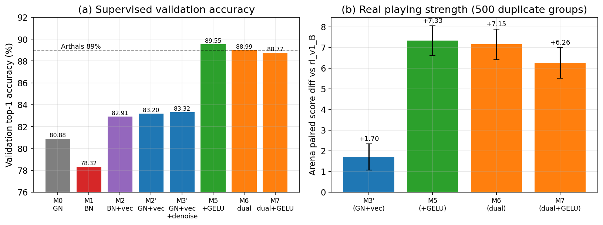
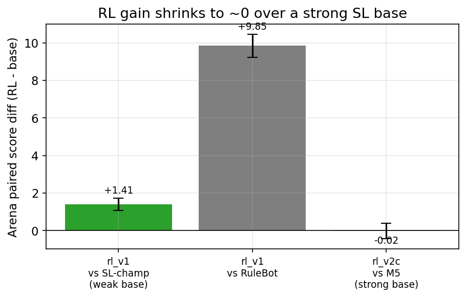

# 国标麻将 AI · Chinese Standard Mahjong AI

国标麻将 AI（Botzone 平台传统算法赛道）：**监督学习基座 + 强化学习探索**。
参加 **IJCAI 2026 第六届麻将 AI 比赛（算法赛道）**，获**积分赛第 3 名**、**决赛第 11 名**。

最终上场的是纯监督学习模型 **M5**（不含 RL）。约 14.5M 参数，验证集 top-1 准确率 **89.5%**，
与我们能找到的最强开源参考在同一口径下持平。

[English summary](#english-summary) · [方法](#方法概述) · [RL 探索](#强化学习探索) · [项目结构](#项目结构) · [使用方法](#使用方法) · [致谢](#致谢与参考)

---

## 成绩

| 项目 | 结果 |
|---|---|
| IJCAI 2026 麻将 AI 比赛 · 积分赛 | **第 3 名**（总分 1668.41） |
| IJCAI 2026 麻将 AI 比赛 · 决赛 | **第 11 名** |
| 上场模型 | M5（纯 SL，fp16 常驻部署） |
| 验证集准确率（masked top-1，全部决策点） | 0.8955 |

---

## 方法概述

### 1. 环境建模与特征工程

- **空间观测**：`uint8` 的 `102×4×9` 多通道张量，34 种牌映射到 4×9 网格（三门花色各占一行，第四行放字牌）。
  通道包括：自己手牌的温度计编码（≥1/≥2/≥3/≥4）、四家副露与暗杠、四家弃牌（全集 + 最近 8 张）、
  待响应牌与出牌者相对位置、未见牌温度计、门风/圈风、牌墙剩余，以及预计算的**向听数**（one-hot）、
  **有效进张掩码**和对应的未见张数。通道索引表见 [`FEATURE.md`](FEATURE.md)。
- **标量特征 vec（107 维）**：每张候选弃牌的质量先验（打出后的向听、进张未见数、是否听牌）
  加上少量全局标量。vec 是 obs 的确定性函数（`feature_v2.compute_vec_from_obs`），
  训练、评测和部署共用这一份实现。
- **动作空间**：235 维（Pass / Hu / Play×34 / Chi×63 / Peng×34 / Gang / AnGang / BuGang），
  和官方框架一致；推理时用合法掩码屏蔽非法动作。
- **自研向听计算** `src/shanten_py.py`：PyMahjongGB 1.3.0 的 `shanten` 系列接口有跨调用状态污染
  （同一输入的返回值取决于调用历史），所以我们自己实现了向听计算，并做了 6 万组隔离用例和
  200 手三方对拍验证。算番器 `MahjongFanCalculator` 不受这个问题影响，继续使用。
- **修正环境** `src/env_fixed.py`：baseline 环境在自摸路径上对"和绝张"重复计数，
  会把按合法掩码行动的 agent 误判为非法。修正版按官方裁判源码对齐语义，并通过全墙重建 + 整局注入、
  逐局比对官方得分的方式取得准入证据（`src/env_certify.py`）。自对弈和评测都用修正版环境。

### 2. 模型：M5

```
obs (102×4×9) ──► 3×3 conv stem (→192 ch)
              ──► 20 × Pre-activation Residual Block  [GroupNorm(8) + GELU]
              ──► GN + GELU
     ┌────────────────────────┴────────────────────────┐
  1×1 conv → 64 ch → flatten                     1×1 conv → 32 ch → flatten
  concat vec(107) → FC 256 → FC 235             concat vec(107) → FC 256 → FC 1
     策略头 (logits)                                 价值头 (V)
```

- **主干**：预激活（PreAct）ResNet，width 192，depth 20。
- **双输入**：空间特征经主干降维后，和 107 维标量 vec **拼接（concat）**。
- **双头**：策略头输出 235 维 logits；价值头输出标量 V（SL 阶段做辅助损失，RL 阶段作 critic）。
- 约 **14.5M** 参数。实现在 `src/model_v2.py`（`MahjongNetV2`）。

### 3. 训练配方与评测口径

- **数据**：98209 局人类对局，展开后约 **1847 万**个决策点；按**对局** 95/5 切分训练/验证（种子 20260610），
  避免同一局同时出现在训练集和验证集。
- **增广**：万/条/筒三门花色有 6 种排列，对空间张量做整体置换，动作和掩码同步置换。
  绿一色、推不倒这类花色不对称的番种会被置换破坏，相关对局不做增广（"去噪"）。
- **优化**：AdamW（lr 6e-4，wd 1e-4），2% warmup + cosine，梯度裁剪 1.0，bf16，batch 1024，20 epoch；
  策略交叉熵带标签平滑（ε=0.05，只平滑到合法动作上），价值头用 SmoothL1×0.5。
- **评测口径**：**不拿验证准确率当棋力的最终判据。** 主判据是 **arena 复式配对对局**：
  候选与对手在**完全相同的牌墙**上轮换座位对打，统计候选得分减去其余三家均值的**配对差值 ± SE**，
  以抵消发牌运气（实现在 `src/arena/`）。所有结论都基于 500 组以上的复式对局。

### 4. 消融结果与关键发现



| 配置 | 改动 | Norm | 激活 | 验证准确率 | arena vs rl_v1_B | arena vs M3′ |
|---|---|---|---|---|---|---|
| M0 | 基线（v1 冠军复现） | GN | ReLU | 0.8088 | — | — |
| M1 | 换 BatchNorm | BN | ReLU | 0.7832 | — | — |
| M2 | BN + vec | BN | ReLU | 0.8291 | — | — |
| M2′ | GN + vec | GN | ReLU | 0.8320 | — | — |
| M3′ | + 去噪 | GN | ReLU | 0.8332 | +1.70 ± 0.64 | 0（基准） |
| M4 | 扩展 vec（117 维） | GN | ReLU | 0.8325 | +0.82 ± 0.68 | +0.21 ± 0.58 |
| **M5** | **+ GELU（最终）** | GN | **GELU** | **0.8955** | **+7.33 ± 0.73** | **+4.42 ± 0.75** |
| M6 | 双分支结构（33M） | GN | ReLU | 0.8899 | +7.15 ± 0.74 | +6.21 ± 0.73 |
| M7 | 双分支 + GELU | GN | GELU | 0.8877 | +6.26 ± 0.74 | +5.54 ± 0.73 |

- **GELU 是最大的杠杆**：只把 ReLU 换成 GELU，验证准确率 +6.22pp（0.8332 → 0.8955），
  arena 对 rl_v1_B 的配对差从 +1.70 升到 +7.33（>5 SE）。这次准确率的提升确实转化成了棋力。
- **vec 特征是特征侧最有效的单项**：净 +2.32pp，其中出牌（Play）决策 +2.68pp，
  因为 vec 直接编码了每张候选弃牌的质量。
- **GroupNorm 优于 BatchNorm**：BN 比 GN 低 2.56pp，且整个训练过程两条曲线没有交叉。
  观测高度稀疏（温度计/one-hot），GN 不依赖 batch 统计量，更稳定；到了 RL 阶段，minibatch 内样本相关，
  BN 的 running stats 还会漂移。所以 SL 和 RL 都用 GN。
- **准确率不等于棋力**：M4 扩展特征后准确率基本没变，arena 却没有提升。
  M6/M7 的双分支结构（参数量是 M5 的 2.3 倍）和 concat + GELU 打平甚至略差，因此没有采用。
- 去噪只带来 +0.12pp，属于噪声水平。

### 5. 部署

Botzone 线上环境为 Python 3.6.5 + torch 1.10.2（CPU），用户存储上限 256MB。
部署采用 **fp16 常驻**方案（`FP16ResidentNetV2`）：权重以 fp16 常驻内存，前向时逐算子临时转成 fp32。
100 局协议级彩排的实测结果：

| 指标 | 实测 |
|---|---|
| 常驻内存（加载后 / 推理峰值） | 182.6 MB / 198.6 MB |
| 单步延迟 p50 / p99 | 0.9 ms / 86.8 ms |
| 首回合耗时 | 0.81 s |
| fp16 与 fp32 决策一致性 | 5006 / 5006 |
| 非法动作 / 崩溃 | 0 / 0 |

---

## 强化学习探索

我们在 SL 基座上做了较系统的 PPO 自对弈微调。**结论是：基座越强，自对弈 RL 的边际收益越小，
在 M5 上已接近 0。** 所以最终上场的是 SL 基座 M5。下面如实列出做过的探索和得到的结论。



**一代 RL（rl_v1，较弱的 v1 SL 基座）**：异步 PPO（共享内存轨迹 + 批量推理服务），
共 2425 次更新、275 万局、1.59 亿决策样本，约 41.8 小时。用 KL 锚定初始策略以防遗忘。
结果：对 SL 冠军 **+1.41 ± 0.32**（2000 组），对规则机器人 +9.85 ± 0.61（SL 基线为 +6.81）。
行为上是在 SL 基础上的轻度保守化精修。
→ [`results/M3_report.md`](results/M3_report.md)、[`results/final_select.md`](results/final_select.md)

**发现 1：只和同源对手自对弈会过拟合。** 后来训练的纯 SL 基座反而能打赢 rl_v1（+2.25，>3 SE）。
rl_v1 只学会了打 SL 同源分布的对手。

**二代 RL（从 M5 热启动，`src/rl/`）**：针对上面的问题，主要做了两件事。
- **对手池风格多样化**：自身快照 55% / M5 锚点 15% / 做大牌陪练 13% / 防守陪练 12% / 旧版 RL 5%。
  每个陪练入池前都要先在 arena 上通过行为指标验收：防守陪练把点炮率从 16.75% 降到 13.94%（≈3 SE），
  做大牌陪练把胜局平均番从 12.79 提到 13.49（1.84 SE）。
  → [`results/spar_acceptance.md`](results/spar_acceptance.md)
- **进攻型奖励塑形**：在奖励里加 `r += α·(fan/8)^p`。线性（α 0.3→0.6）、非线性（p=2,3）、
  封顶（cap 24）都试过，arena 竞争指标一直停在 0.34–0.35，自对弈平均番一直在 ~13.5。
  **根因是信用分配**：做大牌要靠开局就开始的吃碰和定向弃牌布局，单步番数奖励只在和牌那一刻给信号，教不会这种长程布局。
- 两条被验证有效、可复用的稳健化手段：**KL 锚定 M5**（把 vs-M5 配对差从 −0.27 且持续恶化拉回 ~0），
  以及 **eval-best 地板**（−0.5 SE，用来选出对每个对手都不输的均衡候选）。
  最佳候选 rl_v2c 对 M5 为 −0.02 ± 0.42。
  → [`docs/gen2_stage2.md`](docs/gen2_stage2.md)、[`results/gen2_stage2_iter.md`](results/gen2_stage2_iter.md)

**同步 PPO 与信用分配（`src/rl/sync/`）**：单进程同步 PPO，用 KL(π_M5‖π_θ) 锚定。
- Step 2：只用终局零和奖励，β_kl 扫了 0.02 / 0.1 / 0.5，对 M5 为 **−0.4 ~ −0.8**；
- Step 3：改信用分配，**fanback**（终局回报沿轨迹折扣再分配）得 +0.22，
  **potential**（向听势能塑形，Φ=(6−shanten)/6）得 +0.30，方向转正，但都 <2 SE；
- Step 4：把训练量放大 3.5 倍后不再上涨，回落到 ~0。

**评测尺子审计**（[`docs/arena_audit.md`](docs/arena_audit.md)）：确认 arena 没有低估 RL。
在 argmax（即部署口径）下，RL 与 M5 对所有对手都打平；RL 有 97.6% 的决策和 M5 完全一致。
升高温度后 RL 看起来占优，但这是"低熵策略更抗采样噪声"造成的混淆，argmax 部署时兑现不了。

**运气基线 R² 闸门**（`scripts/path_a_gate.py`）：同一架构下，给价值网络喂完美信息
（对手手牌 + 牌墙构成），终局得分预测的 R² 只提高 +0.010（0.0695 → 0.0796）。
可见在当前表征下，信息不完美不是主要瓶颈。

**总结**（[`docs/rl_closeout.md`](docs/rl_closeout.md)）：对 M5 当前的架构和特征而言，自对弈 PPO
已接近 argmax 天花板，继续投入不划算；后续提升应该来自架构、特征或数据。
另外，公开天梯对局的聚合统计也显示，**平均番高不等于均分高**：
天梯上的均衡策略是稳健高效的小牌，这也解释了为什么一味追求高番收益有限。
方案设计稿（完美信息 critic、番数反向信用分配等）见 `docs/`。

---

## 项目结构

```
.
├── README.md / LICENSE / requirements.txt
├── FEATURE.md                 特征 v1 通道索引表(与 src/feature_v1.py 严格同步)
├── baseline/                  课程官方框架(只读参照,也是运行期依赖;不含数据)
│   ├── RL/                    MahjongGBEnv、FeatureAgent、官方 PPO 框架
│   └── SL/                    官方 SL 预处理参照;data/ 下只有数据格式说明
├── src/                       ★ 自研代码(以仓库根目录为工作目录运行)
│   ├── feature_v1.py          102×4×9 观测 + 235 动作 + 合法掩码(FeatureAgentV1)
│   ├── feature_v2.py          vec 标量特征(107 维);feature_v2_ext.py 为 117 维扩展版(M4)
│   ├── shanten_py.py          自研向听/进张计算;shanten_table.py 为可选查表加速
│   ├── replay_driver.py       牌谱重放驱动(预处理/校验/测试共用)
│   ├── preprocess_v1.py       多进程全量预处理 → memmap(obs/mask/act/meta/split)
│   ├── build_vec_v2.py        由 obs 离线生成 vec memmap
│   ├── dataset_v1.py / dataset_v2.py   memmap Dataset + 花色置换增广
│   ├── model_v1.py            MahjongNetV1 + FP16ResidentNet(v1 部署变体)
│   ├── model_v2.py            ★ MahjongNetV2(M5)+ FP16ResidentNetV2(部署变体)
│   ├── model_v2_dual.py       双分支对照结构(消融 M6/M7)
│   ├── train_sl.py / train_sl_v2.py    SL 训练(v1 / v2,M5 配方见下)
│   ├── eval_sl.py             分桶准确率 / 价值头指标 / 混淆矩阵
│   ├── env_fixed.py           修正环境 MahjongGBEnvFixed;env_certify.py 为其准入测试
│   ├── replay_check.py / fan_check.py / brute_shanten_check.py   全量合法性/番数/向听对拍
│   ├── arena/                 ★ 复式评测场:policies / duplicate / run_arena / deviation_probe
│   ├── rl/                    ★ 异步 PPO 框架:config / env_worker / infer_server / train_rl
│   │   └── sync/              ★ 同步 PPO(KL 锚 M5,terminal/fanback/potential/combo 奖励)
│   └── deploy/                ★ Botzone bot:bot_main_v2.py(M5)/ bot_main.py(v1)/ rehearsal.py
├── model/load_model.py        权重加载 + fp16 部署路径一致性自检
├── scripts/                   实验编排(gen2_*.sh 等)、打包、校验、绘图、诊断脚本
├── tests/                     pytest:座位序 / 与 baseline 对拍 / 置换表 / 增广一致性
├── docs/                      RL 方案设计稿、arena 审计、RL 收口记录、figures/
└── results/                   实验结果摘要(arena 报告、SL 评测、部署彩排、RL 迭代记录、曲线图)
```

> `scripts/*.sh`、`src/rl/sync/run_*.sh` 是原始实验编排脚本，保留下来作为可复现记录。
> 它们以及部分 Python 参数的默认路径是训练服务器上的工作目录 `/root/autodl-tmp/mahjong`，
> 在其他机器上运行时，请改掉 `cd` 路径，或通过 `--data` / `--run-dir` / `--out` 等参数显式指定。

---

## 环境依赖

| 场景 | 已验证版本 |
|---|---|
| 训练（GPU） | Python 3.12 + PyTorch 2.8.0（CUDA 12.8，RTX 5090）+ PyMahjongGB 1.3.0 |
| Botzone 部署（CPU） | Python 3.6.5 + torch 1.10.2+cpu + numpy 1.19.5 + PyMahjongGB 1.3.0 |

- SL 训练脚本默认使用 CUDA、bf16 autocast 和 `torch.compile`（可以用 `--no-compile` 关掉），需要 PyTorch ≥ 2.0 和 NVIDIA GPU。
- 部署代码（`src/deploy/`、`model_v*.py` 的 fp16 常驻路径、`feature_*.py`、`shanten_py.py`）
  严格保持 Python 3.6 语法和 torch 1.10 API，不使用 `torch.compile`、`weights_only` 等 2.x 特性。

```bash
conda create -n mahjong python=3.12 -y && conda activate mahjong
pip install torch --index-url https://download.pytorch.org/whl/cu128   # 按本机 CUDA 选择
pip install -r requirements.txt
```

---

## 使用方法

以下命令都在**仓库根目录**执行。

### 0. 准备数据

把官方数据 `data.txt`（98209 局）放到 `baseline/SL/data/`，数据来源见[数据说明](#数据说明)。
官方框架里的 16 局样例 `sample.txt` 也放在这里，可以用来快速跑通流程和单元测试。

### 1. 预处理（牌谱 → memmap）

```bash
python src/preprocess_v1.py --data baseline/SL/data/data.txt --out data_v1 --workers 24
python src/replay_check.py  --data baseline/SL/data/data.txt --workers 24    # 可选:全量重放合法性校验
python src/build_vec_v2.py  --data data_v1 --workers 24                        # vec 标量特征
python scripts/find_asym_fans.py --data-txt baseline/SL/data/data.txt --out data_v1   # 去噪标记(--exclude-asym 需要)
```

> 全量预处理约需数十 GB 磁盘。并行 worker 数要按**内存**预算控制：
> 多进程加上每个进程自己的向听缓存会放大内存占用，缓存上限可用环境变量 `SHANTEN_CACHE_*` 调整。

### 2. 训练 SL 模型（复现 M5）

```bash
python src/train_sl_v2.py --config B --norm gn --act gelu --exclude-asym \
    --epochs 20 --batch 1024 --workers 24 --data data_v1 --run-dir checkpoints/sl_v2_M5_gelu
```

消融对照：去掉 `--act gelu` 即 ReLU（M3′），`--norm bn` 换成 BN，`--dual` 使用双分支结构（M6/M7），
`--vec-ext` 使用 117 维扩展 vec（M4）。

### 3. 评测

```bash
# 验证集准确率(分桶 / 混淆矩阵)
python src/eval_sl.py --ckpt checkpoints/sl_v2_M5_gelu/best.pt --data data_v1 --out results/eval_m5.md

# arena 复式评测:M5 对规则机器人,500 组同墙复式
python src/arena/run_arena.py --candidate nnv2:checkpoints/sl_v2_M5_gelu/best.pt \
    --opponent rule --groups 500 --workers 24 --seed 1234 --out results/arena_m5_vs_rule.md

# 两个模型对打:把 --opponent 也写成模型
python src/arena/run_arena.py --candidate nnv2:<ckpt_a> --opponent nnv2:<ckpt_b> --groups 500
```

策略 spec 可选 `random` | `rule` | `nn:<ckpt>`（v1）| `nnv2:<ckpt>`（M5 结构）| `nnv2dual:<ckpt>`（双分支）| `nnv2ext:<ckpt>`（扩展 vec）。
还支持 `--opponents a,b,c`（三家对手各不相同）、`--temperature`、`--indep-opp` 等参数，详见 `docs/arena_audit.md`。

### 4. 强化学习（可选）

```bash
# 同步 PPO(KL 锚 M5),先跑冒烟
python src/rl/sync/train_rl.py --smoke --workers 8 --games-per-round 120 --rounds 2 --out-dir checkpoints/rl_smoke
# 正式训练示例:potential 奖励
python src/rl/sync/train_rl.py --workers 22 --games-per-round 480 --rounds 100 --reward-mode potential \
    --out-dir checkpoints/rl_potential --set lr=1e-04 minibatch=4096 ppo_epochs=2 beta_kl=0.5

# 异步 PPO 框架(多样化对手池;配置见 src/rl/config.py,可用 --set key=value 覆盖)
python src/rl/train_rl.py --mode gate-smoke --smoke-games 200
python src/rl/train_rl.py --mode main --set max_hours=24
```

所有长任务建议放在 tmux 里跑。RL 的进展**以 arena 复式结果为准**，不要看自对弈指标：
四家用同一个策略时，自对弈指标会失真。

### 5. 部署到 Botzone

```bash
# 打包:产出 dist/botzone_bot_<name>.zip(bot 代码)与 dist/<name>.fp16.pt(fp16 权重)
python scripts/make_bundle.py --ckpt checkpoints/sl_v2_M5_gelu/best.pt --arch v2 --name sl_v2_m5_gelu

# 协议级彩排:完整模拟 Botzone 交互,检查延迟 / 内存 / 合法性 / fp16 一致性
python src/deploy/rehearsal.py --weights dist/sl_v2_m5_gelu.fp16.pt --model-version v2 \
    --games 100 --bot-python <python3.6 + torch1.10 环境的解释器>

# 权重自检(无需 PyMahjongGB)
python model/load_model.py dist/sl_v2_m5_gelu.fp16.pt
```

在 Botzone 上：先把 `.fp16.pt` 上传到"用户存储空间"（线上路径为 `/data/`），
再用打包好的 zip 创建 bot，并开启"长时运行"。

### 6. 测试

```bash
pytest tests/ -q        # 需要 PyMahjongGB 和 baseline/SL/data/sample.txt
```

---

## 模型权重说明

模型权重（`*.pt`）体积较大，**不随仓库发布**。可以按上面第 1、2 步从头训练得到。
M5 在单张 RTX 5090 上训练 20 epoch。
`model/load_model.py` 可以检查 checkpoint 能否正常加载，并验证 fp16 部署路径和 fp32 路径的输出是否一致。

checkpoint 格式：`{'config': {...}, 'state_dict': ..., 'val_acc': ...}`，
其中 M5 的 config 为 `{width:192, depth:20, norm:'gn', act:'gelu', vec_dim:107, actions:235}`。

## 数据说明

训练数据是课程官方提供的 **98209 局 Botzone 平台国标麻将人类对局记录**（`data.txt`，约 200MB），
每局都可以通过 `https://botzone.org.cn/match/<ID>` 查看对局回放。
数据格式见 [`baseline/SL/data/README.txt`](baseline/SL/data/README.txt)。
由于体积和版权原因，**训练数据和对局数据都不包含在本仓库中**，请从课程或 Botzone 官方渠道获取。

---

## 致谢与参考

- **Arthals（卓致用）**：往届课程优秀作业
  [zhuozhiyongde/Fundamentals-of-Artificial-Intelligence-2024Spring-PKU](https://github.com/zhuozhiyongde/Fundamentals-of-Artificial-Intelligence-2024Spring-PKU)。
  本项目 SL 基座的特征设计（每弃牌质量标量、双输入思路）和训练配方（GELU、优化设置等）参考了该作业，特此说明。
  双分支对照结构 `src/model_v2_dual.py` 复刻自该作业，仅用于消融对比。
- [Botzone](https://botzone.org.cn) 平台、官方[国标麻将裁判程序](https://github.com/ailab-pku/Chinese-Standard-Mahjong)，
  以及课程提供的 baseline 框架（`baseline/`）。
- [PyMahjongGB](https://pypi.org/project/PyMahjongGB/)：国标麻将算番库。

**参考文献**

1. Li, J., Koyamada, S., Ye, Q., et al. *Suphx: Mastering Mahjong with Deep Reinforcement Learning.* arXiv:2003.13590, 2020.
2. Schulman, J., Wolski, F., Dhariwal, P., Radford, A., Klimov, O. *Proximal Policy Optimization Algorithms.* arXiv:1707.06347, 2017.
3. Schulman, J., Moritz, P., Levine, S., Jordan, M., Abbeel, P. *High-Dimensional Continuous Control Using Generalized Advantage Estimation.* ICLR, 2016.
4. He, K., Zhang, X., Ren, S., Sun, J. *Deep Residual Learning for Image Recognition.* CVPR, 2016.
5. He, K., Zhang, X., Ren, S., Sun, J. *Identity Mappings in Deep Residual Networks.* ECCV, 2016.
6. Hendrycks, D., Gimpel, K. *Gaussian Error Linear Units (GELUs).* arXiv:1606.08415, 2016.
7. Wu, Y., He, K. *Group Normalization.* ECCV, 2018.
8. Ng, A. Y., Harada, D., Russell, S. *Policy Invariance under Reward Transformations: Theory and Application to Reward Shaping.* ICML, 1999.
9. Li, X., et al. *Tjong: A Transformer-based Mahjong AI via Hierarchical Decision-Making and Fan Backward.* CAAI Transactions on Intelligence Technology, 2024.

## License

[MIT](LICENSE)

---

## English Summary

A Chinese Standard Mahjong (Guobiao) AI for the [Botzone](https://botzone.org.cn) platform, built as a
supervised-learning base plus reinforcement-learning exploration. It entered the **IJCAI 2026 Mahjong AI
Competition (algorithm track)** and placed **3rd in the points round** and **11th in the final**.
The submitted bot is the pure-SL model **M5**; it contains no RL.

**Method.**
- **Features.** The spatial observation is a `102×4×9` tensor: hand thermometers, melds, discards, unseen-tile
  counts, winds, wall size, and precomputed shanten / effective-draw masks. A 107-dim scalar vector `vec`
  adds per-discard quality priors.
- **Model M5** (~14.5M params). A pre-activation ResNet trunk (width 192, depth 20) with GroupNorm and GELU.
  The trunk features are concatenated with `vec` and feed a policy head (235 actions) and a value head.
- **Training.** Behavior cloning on 98,209 human games (~18.5M decisions). Suit-permutation augmentation,
  AdamW, cosine schedule, bf16. Validation top-1 accuracy is **89.5%**.
- **Evaluation.** We judge playing strength by duplicate matches ("arena"): identical walls, rotated seats,
  and paired score difference ± SE. Validation accuracy alone is not the final criterion.

**Key ablation findings.**
- **GELU is the biggest lever:** +6.2pp accuracy and +5.6 paired score.
- **The `vec` features add +2.3pp.**
- **GroupNorm beats BatchNorm by 2.6pp.**
- **Dropped:** a dual-branch network (2.3× params) and extended features did not help, so neither was adopted.

**RL exploration** (PPO self-play from the SL base):
- **Weak base:** RL improves a weaker SL base (+1.41 ± 0.32).
- **Strong base:** the gain shrinks to ~0 over M5.
- **Fan-based reward shaping** hits a credit-assignment ceiling.
- **Credit-assignment variants** (fan-backward, potential-based shaping) flip the sign but stay within 2 SE.
- **Audits:** an arena audit and a perfect-information R² gate both indicate a near-argmax ceiling for the
  current architecture and features.
- **Reusable lessons:** a diverse opponent pool, a KL anchor to the base policy, and an eval-best floor.

**Quick start.**
1. Place the official `data.txt` (not included) in `baseline/SL/data/`.
2. Run `src/preprocess_v1.py`, then `src/build_vec_v2.py`, then `scripts/find_asym_fans.py`.
3. Train with `src/train_sl_v2.py --config B --norm gn --act gelu --exclude-asym`.
4. Evaluate with `src/arena/run_arena.py`.
5. Package with `scripts/make_bundle.py --arch v2`.

Model weights and data are not included in this repository.

**Acknowledgements.**
- The feature design and training recipe draw on the earlier course project by
  [Arthals (Zhiyong Zhuo)](https://github.com/zhuozhiyongde/Fundamentals-of-Artificial-Intelligence-2024Spring-PKU).
- The `baseline/` folder is the course-provided framework.
